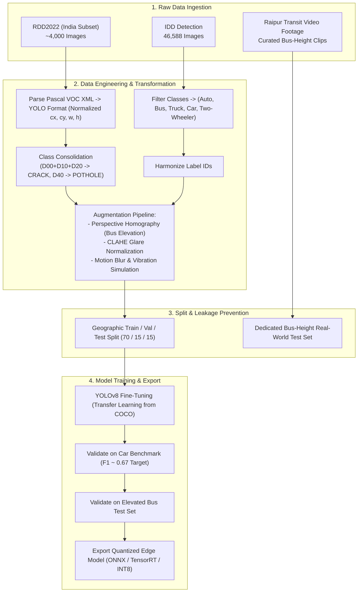

# Datasets & Data Engineering Strategy — FLINT / Urban Sense

### Dataset Selection, Annotation Strategy & Camera-Perspective Engineering (BEL Hackathon)

---

## 1. Main Research Question

> **Which public and localized datasets can realistically support our AI-powered urban sensing MVP, and what data-engineering challenges (camera elevation, Indian traffic conditions, class consolidation) must be solved before models can work reliably with bus-mounted camera footage?**

---

## 2. Executive Conclusion

* **Core Dataset Pillar:** **RDD2022** and **IDD (India Driving Dataset)** form the primary foundation for our MVP. RDD2022 provides annotated Indian road-damage imagery, while IDD captures unstructured Indian traffic scenes, vehicle types, and road environments across Hyderabad and Bengaluru.
* **The Perspective & Elevation Gap:** Public driving datasets are almost universally collected using **car-mounted dashcams ($1.1\text{--}1.3\text{ m}$ height)**. Transit buses have cameras mounted at **$2.2\text{--}2.8\text{ m}$ elevation looking downward at a steeper pitch**. Deploying models directly without perspective adaptation leads to severe false-positive rates and missed detections.
* **Pragmatic Scope Control:** High-quality detection-ready datasets for **waterlogging** on Indian roads are virtually non-existent, and **pedestrian intent** cannot be solved through static bounding boxes. Both must be treated as secondary/experimental capabilities rather than core MVP promises.
* **Engineering Priority:** Focus on **data quality, class consolidation, perspective augmentation, and multi-frame validation** rather than simply hoarding more raw images.

---

## 3. Key Dataset Findings — Confirmed ✅

| Dataset / Evidence | Primary Source | Volume & Format | Relevance to Urban Sense |
| :--- | :--- | :--- | :--- |
| **RDD2022 (Road Damage Dataset)** | [github.com/sekilab/RoadDamageDetector](https://github.com/sekilab/RoadDamageDetector) | 47,000+ images across 6 countries; dedicated **India subset** (~4,000 images) with Pascal VOC XML / YOLO boxes. | Provides the core ground-truth for Indian road-surface defects (potholes and cracks) without needing to annotate thousands of images from scratch. |
| **RDD2022 4-Class Breakdown** | [openconstruction.org](https://openconstruction.org) | 4 classes: `D00` (Longitudinal), `D10` (Transverse), `D20` (Alligator), `D40` (Pothole). | Establishes the exact labels for class consolidation into operationally actionable municipal categories. |
| **IDD (India Driving Dataset) Detection** | [idd.insaan.iiit.ac.in](https://idd.insaan.iiit.ac.in) (IIIT-H) | 46,588 images across Hyderabad & Bengaluru with train/val/test splits. | Captures unstructured Indian driving scenes, lane indiscipline, and regional vehicle types missing from Western datasets. |
| **IDD Dataset Variants** | [inai.iiit.ac.in/domains/idd.html](https://inai.iiit.ac.in/domains/idd.html) | Detection, Temporal, Lite, Multimodal, and Segmentation packages. | Allows selecting lightweight bounding-box detection sets for edge training while referencing temporal sequences for tracking. |
| **IDD Multimodal** | [inai.iiit.ac.in/domains/idd.html](https://inai.iiit.ac.in/domains/idd.html) | Stereo cameras + synchronized GPS, LiDAR, and OBD telemetry. | Proves the feasibility of pairing visual detections with geographic coordinates for geo-tagged urban sensing. |
| **INSAAN IDD-117K** | [insaan.iiit.ac.in/datasets](https://insaan.iiit.ac.in/datasets) | 117,000+ extended driving frames. | Demonstrates a clear expansion pathway if larger-scale pretraining is required post-hackathon. |
| **Mapillary Vistas** | [Neuhold et al., ICCV 2017](https://openaccess.thecvf.com) | 25,000 high-resolution global street-level images with diverse weather/lighting. | Useful for validating whether edge backbones generalize across variable weather, dusk/dawn, and rainy conditions. |
| **BDD100K** | [bdd-data.berkeley.edu](https://bdd-data.berkeley.edu) | 100,000 driving video sequences with temporal annotations. | Serves as reference material for temporal sampling rates and frame-to-frame association. |

---

## 4. Uncertainties & Data Challenges ⚠️

| Challenge / Uncertainty | Root Cause | Engineering Solution & Validation |
| :--- | :--- | :--- |
| **Bus Elevation & Pitch Gap** | RDD2022 and IDD use car windshield mounts ($1.2\text{ m}$ height). Bus cameras sit at $2.5\text{ m}$ looking downward at a $15^\circ\text{--}25^\circ$ angle. | **Synthetic Affine Perspective Augmentation:** Apply homography matrix transforms during training to simulate higher camera pitch. Validate against real bus-height footage filmed in Raipur. |
| **Fine-Grained Class Confusion** | Distinguishing `D00` (longitudinal crack) from `D10` (transverse crack) consumes edge model capacity without offering distinct municipal utility. | **Class Consolidation:** Merge `D00`, `D10`, and `D20` into a unified **`CRACK`** class; maintain **`POTHOLE`** (`D40`) separately. |
| **Waterlogging Dataset Scarcity** | No large-scale, YOLO-ready public dataset exists for Indian road waterlogging. Most flood sets are classification-only (whole-image disaster scenes). | **Tier 2 VLM Routing:** Rather than forcing YOLO to detect water patches, route candidate wet road frames to on-premise **Qwen3-VL** via pixel reflectance heuristics. |
| **Pedestrian Intent Limitations** | Public datasets label bounding boxes, not intention to cross. Pedestrian crossing behavior in Indian traffic is highly non-linear. | **TTC Trajectory Estimation:** Replace speculative "intent" with deterministic **Time-to-Collision (TTC)** derived from ByteTrack bounding box growth rates. |
| **Environmental Degradation (Dust / Glare)** | Indian summer sun causes road overexposure; monsoons cause rain streaks; dry seasons cause heavy airborne dust. | **Preprocessing Normalization:** Apply Contrast Limited Adaptive Histogram Equalization (CLAHE) and glare-filtering in the edge ingestion pipeline. |

---

## 5. Dataset Comparison Matrix

| Dataset | Primary Strength | Critical Gap | FLINT Strategy |
| :--- | :--- | :--- | :--- |
| **RDD2022 (India Subset)** | Real Indian potholes & asphalt distress annotations | Captured at car windshield level; high class imbalance | Fine-tune YOLOv8n; consolidate crack classes; apply perspective warping |
| **IDD Detection** | Highly accurate for auto-rickshaws, bikes, buses, and pedestrians | Car dashcam perspective; complex hierarchical label tree | Extract 5 core vehicle classes (`BUS`, `AUTO`, `CAR`, `TRUCK`, `TWO-WHEELER`) |
| **MS COCO** | Massive scale (330k images); excellent general feature representations | Lacks specific Indian vehicle types and road defect annotations | Use strictly for **backbone pretraining weights** (`yolov8n.pt`) |
| **Mapillary Vistas** | Exceptional road infrastructure diversity (signboards, curbs, lanes) | Underrepresents heavily degraded Indian arterial roads | Use as cross-validation benchmark for lighting and weather diversity |
| **Public Flood Datasets** | General imagery of flooded urban areas | Classification-only; non-bounding-box; lacks road-puddle granularity | Do not train on edge; delegate to Tier 2 VLM verification |

---

## 6. Data Engineering Pipeline: Keep, Modify, Drop, Add

### What We KEEP 🟢
* **RDD2022 (India Subset):** Primary source for road defect ground truth.
* **IDD (India Driving Dataset):** Primary source for local traffic classification.
* **Pretrained YOLO Backbones:** Transfer learning from COCO-pretrained weights rather than training from scratch.
* **Strict Split Hygiene:** 70% Train / 15% Val / 15% Test partitioned by geographic location to prevent spatial data leakage.

### What We MODIFY 🟡
* **Class Consolidation Scheme:**
  ```
  RDD2022 Original:
  ├── D00 (Longitudinal Crack) ──┐
  ├── D10 (Transverse Crack)   ──┼──> FLINT Class: CRACK (Scheduled Resurfacing)
  └── D20 (Alligator Crack)    ──┘
  ├── D40 (Pothole)            ──────> FLINT Class: POTHOLE (Emergency Repair)
  ```
* **Geometric Perspective Warping:**
  Synthetically transform training images using a homography matrix:
  $$\begin{bmatrix} x' \\ y' \\ 1 \end{bmatrix} = \mathbf{H} \begin{bmatrix} x \\ y \\ 1 \end{bmatrix}$$
  Simulates a camera elevation shift from $1.2\text{ m}$ to $2.5\text{ m}$ with downward tilt.

### What We DROP 🔴
* **Direct Transfer Assumptions:** Never claim a model trained on car dashcams will deliver identical accuracy on buses without elevation adaptation.
* **Classification-Only Flood Sets:** Discard raw disaster-relief flood images that confuse road surface models.
* **Fine-Grained Crack Distinctions:** Dropping transverse vs longitudinal separation saves compute and boosts overall precision on edge hardware.

### What We ADD 🔵
* **Custom Bus Validation Set:** A curated test clip recorded from an elevated bus perspective along Raipur transit corridors (GE Road / VIP Road).
* **Ground ROI Masking:** Binary polygonal mask ignoring the upper 40% of the image (sky, horizon, tree line) to eliminate sky reflections and background noise.
* **Multi-Frame Temporal Validation:** Minimum 3-frame tracking persistence required before recording a ground-truth detection.
* **Improvement 4: 3-Axis IMU Shockwave Telemetry Streams:** Paired $Z$-axis acceleration profiles aligned with GPS and camera timestamps to validate physical pothole impacts (suspension shockwave $\approx 0.3\text{ s}$ after optical detection).
* **Improvement 2: Dual-Frame Temporal Sequence Pairs ($0.5\text{ s}$ Delta):** Video frame pairs sampled $0.5\text{ s}$ apart for optical flow variance evaluation, distinguishing specular water reflection from rigid planar asphalt.

---

## 7. End-to-End Data Engineering Workflow



---

## 8. Final Hackathon Recommendations

1. **Be Transparent About Dataset Limits:** When judges ask about training data, explain that RDD2022 provided the defect foundation, IDD provided Indian vehicle dynamics, and affine perspective augmentation bridged the bus elevation gap.
2. **Justify Class Consolidation:** Defend merging crack types by explaining municipal operational realities: city engineers need to know if a road needs *immediate cold patch* (pothole) vs *scheduled overlay* (crack).
3. **Showcase Synthetic Bus-Angle Augmentation:** Demonstrating that you mathematically tilted car footage to simulate bus heights proves advanced computer vision maturity.
4. **Emphasize Data Quality Over Volume:** A clean, consolidated dataset with persistence filtering beats an uncurated 100k-image scrape every single time.

---

## 9. Primary Dataset Access & References

* **RDD2022 Repository:** [https://github.com/sekilab/RoadDamageDetector](https://github.com/sekilab/RoadDamageDetector)
* **India Driving Dataset (IDD):** [https://idd.insaan.iiit.ac.in/](https://idd.insaan.iiit.ac.in/)
* **INSAAN Dataset Portal:** [https://insaan.iiit.ac.in/datasets/](https://insaan.iiit.ac.in/datasets/)
* **Mapillary Vistas:** [https://www.mapillary.com/dataset/vistas](https://www.mapillary.com/dataset/vistas)
* **BDD100K Dataset:** [https://bdd-data.berkeley.edu/](https://bdd-data.berkeley.edu/)
