```mermaid
flowchart TD
    subgraph OnboardBus ["Stage 1 & 2: On-Bus Recording & Access"]
        CCTV["Bus CCTV Cameras\n(Front / Rear / Side)"] --> DVR["Onboard DVR / NVR & HDD\n(Untouched Recording Loop)"]
        DVR --> VideoAccess["Recorded Video Stream / Playback\n(RTSP / ONVIF / File)"]
    end

    subgraph EdgeAI ["Stage 3 & 4: Intelligent Edge Processing"]
        VideoAccess --> FrameSampler["Frame Sampler & Preprocessor"]
        FrameSampler --> Tier1["Tier 1: Always-On Specialist Models\n(YOLOv8 + ByteTrack)"]
        FrameSampler --> Tier2Trigger["Tier 2: Event Triggers\n(Geofence KDTree + Optical Flow)"]
        
        Tier1 --> MultiFrame["Multi-Frame Persistence Filter\n(N Consecutive Detections)"]
        MultiFrame --> IMUFusion["Improvement 4: Bumper Vibration / IMU Fusion\n(Z-Axis G-Force Spike ~0.3s)"]
        
        Tier2Trigger --> OpticalFlow["Improvement 2: Dual-Frame Epipolar Motion\n(0.5s Apart Specular Check)"]
        OpticalFlow --> EvidenceSelect["Best Evidence Frame Extractor"]
        
        IMUFusion --> JSONEvent["Package JSON Event Payload\n(Minimizing Network Bandwidth)"]
        EvidenceSelect --> JSONEvent
    end

    subgraph CentralPlatform ["Stage 5: Central Orchestration & Spatial DB"]
        JSONEvent --> Backend["Central FastAPI Backend\n(Ingestion & Queue Orchestrator)"]
        Backend --> VLMQueue{"Requires VLM\nVerification?"}
        
        VLMQueue -- Yes --> VLMServer["Private On-Premise VLM Server\n(Ollama + Qwen3-VL)"]
        VLMServer --> MergeEvent["Merge Structured VLM Verification\nwith Edge Event"]
        MergeEvent --> PostGIS[("PostgreSQL + PostGIS\nSpatial Clustering & Event Store")]
        
        VLMQueue -- No --> PostGIS
    end

    subgraph OperationDashboard ["Stage 6 & 7: Intelligence Dashboard & Review"]
        PostGIS --> Dashboard["Urban Intelligence Dashboard\n(Command Center, GIS Map, Analytics)"]
        Dashboard --> Review{"Transport Authority Review\n'AI Detects, Human Decides'"}
        Review -- Reject --> LogFalsePositive["Audit Trail & Model Feedback Log"]
        Review -- Approve --> ComplaintEngine["Complaint Generation & Action Engine"]
    end

    subgraph GovernmentAction ["Stage 8: Official Remediation"]
        ComplaintEngine --> PriorityScoring["Improvement 3: Severity-Weighted Priority Scoring\n(Priority = Severity × Traffic × Bus Confirmations)"]
        PriorityScoring --> PathA["Path A: Emergency / Critical Incident\n(Priority 1: Immediate Direct Dispatch)"]
        PriorityScoring --> PathB["Path B: Recurring Defect Cluster\n(Scheduled Maintenance Batching)"]
        PathA --> PWD["Government Department Workflows\n(PWD / Traffic Dept / Smart City)"]
        PathB --> PWD
        PWD --> Resolved["Field Verification & Physical Repair"]
    end
```

# Solution Flow — FLINT / Urban Sense

### AI-Powered Bus-Camera Urban Sensing Platform (BEL Hackathon)

This document describes the complete end-to-end data flow of the system — from existing bus camera recordings to authority-reviewed, actionable government interventions.

---

## 1. Flow Overview

```
CCTV (Bus) → DVR/NVR → HDD Recording → Recorded Video Access
    → Edge Device → AI Models (Tier 1 Edge + Tier 2 VLM Trigger)
    → JSON Events → Central FastAPI Backend
    → Selective On-Premise VLM Verification (Ollama + Qwen3-VL)
    → PostgreSQL + PostGIS (Spatial Clustering)
    → Urban Intelligence Dashboard (React + MapLibre/Leaflet)
    → Authority Review & Human Decision
    → Complaint Generation Engine
    → Government Workflow / Action (PWD, Traffic Police, Municipal Corp)
```



---

## Stage 1 — CCTV Recording (On-Bus)

Bus-mounted cameras (front, rear, side, and cabin) continuously record video to the bus's onboard **DVR/NVR and existing hard disk**, exactly as deployed in municipal fleets today for security, passenger safety, and legal incident retention.

* **Non-Invasive Integration:** This existing recording pipeline is **completely untouched by our system**. It continues independently regardless of edge AI operation downstream.
* **Prototype Simulation:** Simulated using pre-recorded bus and dashcam-style test footage.

---

## Stage 2 — Recorded Video Access from DVR/NVR

The edge device taps into **video recorded by the existing DVR/NVR**, avoiding costly camera retrofits or proprietary hardware replacement.

In physical production deployments, video retrieval uses standardized interoperability protocols:
* **RTSP (Real-Time Streaming Protocol):** For supported video streaming/playback access.
* **ONVIF:** For standardized IP camera device and profile interoperability.
* **Vendor SDK / API / Playback Export:** Where specialized storage buses or NVR file systems are utilized.
* **Prototype Simulation:** Handled via Python's OpenCV loop (`cv2.VideoCapture()`), functionally equivalent to reading an RTSP stream.

---

## Stage 3 — Edge Device Runs AI Models

The edge hardware (Jetson Orin, RK3588, or industrial x86 edge computer) processes video **locally on the bus**, running a **two-tier detection strategy** structured by data availability and compute efficiency.

### Tier 1 — Edge Specialist Models (Always-On, Offline-Capable, Zero API Cost)
Used for high-frequency hazards backed by mature, annotated datasets:
1. **Frame Extraction:** Sampled at a fixed frame rate (e.g. 5–10 FPS) rather than processing every raw frame, conserving compute and power.
2. **Specialist Detection (YOLOv8):**
   * **Road Surface Defects:** Fine-tuned on RDD2022 (Indian road subset) for potholes and asphalt cracks.
   * **Traffic & Vehicles:** Trained on IDD (India Driving Dataset) + COCO (auto-rickshaws, buses, trucks, cars, motorcycles).
   * **Pedestrian Safety:** COCO `person` detection within an elevated bus bumper Region-of-Interest (ROI).
3. **Multi-Object Tracking (ByteTrack):** Assigns persistent IDs across consecutive frames. Prevents double-counting vehicles for traffic density and prevents generating dozens of alerts for a single pothole.
4. **Pedestrian Risk Assessment (Time-to-Collision — TTC):** Computes rate of bounding-box spatial expansion to identify imminent collision trajectories rather than using speculative "intent" heuristics.
5. **ANPR (Proof of Concept):** Plate detection $\rightarrow$ bounding box crop $\rightarrow$ EasyOCR / PaddleOCR text recognition on curated frames.
6. **Multi-Frame Persistence Filter:** Detections must persist across $N$ consecutive frames ($N \ge 3$) before generating an event, eliminating transient road shadows and camera jitter false positives.
7. **Improvement 4: Bumper Vibration / Accelerometer Fusion (The Ultimate Edge Co-Validation):** Edge devices (or phone/tablet test units) have built-in 3-axis IMU/accelerometers ($Z$-axis bump detection). If YOLO detects a dark depression on the asphalt AND the bus suspension registers a vertical $Z$-axis G-force spike 0.3 seconds later as the wheels hit it: That is 100% ground-truth confirmation of a deep pothole. It drops the false-positive rate to near zero.

### Tier 2 — Local VLM Verification (Selective, Event-Triggered, Private On-Premise)
Used for complex semantic hazards where standard bounding-box detectors struggle:
* Waterlogging / ponding
* Missing road dividers / median barriers
* Faded or missing zebra crossings
* Damaged or obscured regulatory signboards

To prevent crushing edge compute, VLMs **never process continuous video**. Instead, lightweight edge triggers select candidate frames for secondary verification:

* **Geofenced Triggers:** Checks expected civic infrastructure points (preloaded from OpenStreetMap) against live GPS via a `scipy.spatial.KDTree` query. When the bus is within $\approx 30\text{ m}$ of a known divider or crossing, a single evidence frame is captured (subject to a 24-hour location cooldown).
* **Improvement 2: Dual-Frame Epipolar / Motion Verification for Water (Simple CV Upgrade):** For waterlogging: instead of just single-frame sky reflectance, look at two frames 0.5s apart: Potholes and road texture move predictably across the frame with the bus's optical flow. Standing water has specular reflection that glints and ripples differently from rigid asphalt texture. Adding optical flow consistency to your Tier 2 trigger eliminates false triggers on dry, shiny asphalt.
* **Rate Limiting:** A strict cap (e.g., maximum 5 verification requests/minute per bus) prevents bandwidth spikes.

```mermaid
flowchart LR
    EdgeTrigger["Edge Trigger Fires\n(Geofence KDTree / Visual Anomaly)"] --> BestFrame["Select Best Frame"]
    BestFrame --> PreliminaryEvent["Preliminary JSON + Evidence Frame"]
    PreliminaryEvent --> FastAPI["Central FastAPI Backend"]
    FastAPI --> VLMQueue["VLM Verification Queue"]
    VLMQueue --> Ollama["Private VLM Server (Ollama)"]
    Ollama --> Qwen["Qwen3-VL Inference"]
    Qwen --> JSONResult["Structured JSON Result"]
    JSONResult --> Merge["Merge with Edge Event"]
```



**VLM Output Example:**
```json
{
  "hazard_type": "waterlogging",
  "severity": "moderate",
  "description": "standing water covering ~half the lane width",
  "visual_confidence": "medium"
}
```

* **Data Privacy:** Runs strictly on a private on-premise GPU server using **Ollama + Qwen3-VL**. No external commercial APIs are used, keeping municipal data and video evidence strictly sovereign.

---

## Stage 4 — JSON Event Generation

To **minimize cellular network bandwidth** over 4G/5G, raw video **never leaves the bus**. Only confirmed JSON event packets with compressed evidence crops are transmitted.

```json
{
  "id": "evt_1029",
  "bus_id": "BUS_07",
  "route_id": "route_2",
  "alert_type": "pothole",
  "source": "edge_model",
  "confidence_score": 0.94,
  "latitude": 21.2528,
  "longitude": 81.6489,
  "timestamp": "2026-09-06T10:32:15Z",
  "severity": "medium",
  "status": "new",
  "evidence_image_url": "/evidence/evt_1029.jpg",
  "area_label": "Pandri",
  "metadata": {
    "speed_kmh": 32.4,
    "consecutive_frames": 4,
    "class_raw": "D40"
  }
}
```

---

## Stage 5 — Central Backend, VLM Orchestration & Database

A central **FastAPI** backend acts as the gateway and event engine:
* Ingests edge events via `POST /api/ingest/detection` or `POST /alerts`.
* Queues Tier 2 candidate frames for on-premise VLM processing.
* Emits Server-Sent Events (SSE) / WebSockets to push live updates to the web dashboard.
* **Store-and-Forward:** If cellular connectivity drops, edge devices buffer events locally in an SQLite cache and replay them once reconnected.

### Spatial Database (PostgreSQL + PostGIS)
PostGIS powers core geographic capabilities:
* **Spatial Indexing (`GIST`):** Rapid querying of detections along specific bus routes or ward boundaries.
* **Spatial Clustering (`ST_ClusterDBSCAN`):** Automatically groups repeated detections of the same pothole or hazard from multiple buses into a single actionable incident.

---

## Stage 6 — Urban Intelligence Dashboard

Built with **React, TypeScript, Tailwind CSS, and MapLibre GL**, querying the central backend to provide operational visibility across the city:

1. **Command Center (`/command-center`):** High-level municipal KPIs, live Raipur corridor map, and Route Intelligence review summaries.
2. **Live Map (`/live-map`):** Interactive GIS map with layer filters (Road Defects, Traffic, Safety), bus markers, and inspectable defect evidence dialogs.
3. **City Analytics (`/analytics`):** Corridor health rankings (defects per km), hazard category distributions, and hourly activity heatmaps.
4. **Live Alert Queue (`/live-alerts`):** Priority triage queue tracking lifecycle statuses (`NEW` $\rightarrow$ `ACKNOWLEDGED` $\rightarrow$ `RESOLVED`).
5. **Fleet Overview (`/fleet`):** Real-time bus telemetry, assigned routes, and onboard edge hardware health.
6. **System Status (`/system-status`):** Ingestion pipeline latency, database status, and VLM queue health.

---

## Stage 7 — Authority Review & Decision

Urban Sense adheres to a strict operational doctrine:

> **AI detects. AI recommends. Human authority decides.**

Before any official civic grievance or government work-order is raised, municipal officers review the evidence on the dashboard to eliminate false positives.

```
AI Detection / Cluster
        ↓
Dashboard Review
        ↓
┌─────────────────┬─────────────────┐
│     Approve     │     Reject      │
└────────┬────────┴────────┬────────┘
         ↓                 ↓
     Complaint      Logged as False
    Generation      Positive / Audit
```

| Authority Action | Description | System Effect |
| :--- | :--- | :--- |
| **Inspect** | View GPS, timestamp, confidence score, and photo crop | Opens detail modal |
| **Update** | Re-classify severity or append field notes | Updates database record |
| **Approve** | Validate defect for work-order creation | Triggers complaint generator |
| **Reject** | Flag as shadow, reflection, or non-issue | Logs as false positive for model retraining |

---

## Stage 8 — Complaint Generation & Government Action

Once approved by human authority, the **Complaint Generation Engine** dispatches work orders through two structured workflows:

### Path A — Emergency / Critical Incidents
For high-severity road hazards (e.g. open manholes, major tree falls, severe crater potholes):
* Dispatched immediately upon single authority verification.
* Escalated via SMS/WhatsApp/API alert to the on-duty ward engineer.

### Path B — Recurring Defect Clustering
For ordinary road wear and minor potholes, multiple buses passing the same spot consolidate into a single ticket:
* **Trigger Conditions:**
  * $\ge 3$ detections of the same type
  * Within $\approx 300\text{--}500\text{ m}$ radius
  * Observed by $\ge 2$ distinct buses
  * Within a rolling 7-day window
* **Result:** Prevents PWD engineers from receiving 50 duplicate complaints for the same pothole on GE Road.

### Improvement 3: Severity-Weighted Priority Scoring (Municipal Triage)
In your complaint engine, introduce a composite Criticality Index:

$$\text{Priority} = (\text{Severity Score}) \times (\text{Traffic Density of Corridor}) \times (\text{Number of Unique Bus Confirmations})$$

* **High-Impact Escalation:** A pothole on GE Road (high transit volume, verified by multiple bus passes) gets elevated to PWD Priority 1 (Immediate Dispatch).
* **Routine Batching:** A surface crack on an empty depot road receives a low composite score and gets batched into scheduled monthly maintenance.

### Complaint Lifecycle & Government Hand-off
```
Approved Incident
      ↓
Complaint Draft (Auto-populated with GPS, evidence photo, defect classification)
      ↓
Authority Confirmation & Digital Sign-off
      ↓
Submitted to Govt System (State PWD, Municipal Grievance, CM Helpline API)
      ↓
Field Crew Dispatched → Physical Repair Completed → Resolved
```

---

## 9. End-to-End System Summary

| Stage | Location | Primary Tech Stack | Bandwidth / Payload |
| :--- | :--- | :--- | :--- |
| **1. Recording** | Bus CCTV / DVR | Cameras, NVR, Local HDD | High (Local RAW video) |
| **2. Video Access**| Bus Onboard | RTSP / ONVIF / OpenCV | Local internal bus loop |
| **3. Edge AI** | Bus Edge Computer | YOLOv8, ByteTrack, KDTree | Edge local processing |
| **4. Event Gen** | Edge $\rightarrow$ Cloud | Python, JSON, REST / Cellular | Tiny (~2 KB JSON + ~50 KB JPEG) |
| **5. Central Hub** | Central Server | FastAPI, PostgreSQL, PostGIS | Server-side orchestration |
| **6. VLM Audit** | On-Premise GPU | Ollama, Qwen3-VL | Internal private network |
| **7. Dashboard** | Control Center | React, MapLibre GL, Vite | Client-side dashboard queries |
| **8. Authority** | Municipal Office | Role-Based UI Review | Human-in-the-loop decision |
| **9. Gov Action** | Field Depts | PWD API / Work Orders | Formal civic resolution |
